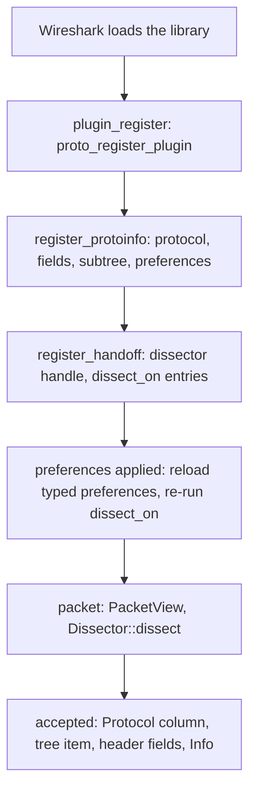

# Architecture

## Crates

| Crate | Depends on | Holds |
| --- | --- | --- |
| `libwireshark-sys` | bindgen, pkg-config (build) | bindings generated from the header bundles; links Wireshark |
| `libwireshark` | `libwireshark-sys`, libloading; `libwireshark-derive` with `derive` | the plugin API and its runtime |
| `libwireshark-derive` | syn, quote | `#[derive(Header)]`, `#[derive(Preferences)]` |
| `cargo-wireshark` | clap, bindgen, ureq, archive readers | installation discovery; bundle generation and the `headers` branch |
| `libwireshark-api` | guatiao | the guatiao kinds providers implement, their models, the C header; links no Wireshark |
| `libwireshark-guatiao` | `libwireshark` (`host`), `libwireshark-api`, guatiao | the plugin serving providers, and the `wireshark_host` provider |
| `bindings/python` (`libwireshark` on PyPI) | guatiao's Python binding | the kinds as classes, typed helpers, and `Host` |

`examples/` are plugin `cdylib`s, and `examples/guatiao/` providers;
`libwireshark`'s and `libwireshark-guatiao`'s tshark tests load them.

## Header bundles

A bundle is one self-contained C header. `wireshark-<major>-<minor>.h` holds
a release line's declared public headers (`epan`, `epan/dfilter`,
`epan/ftypes`, and the TCP/UDP dissector headers) with their transitive
includes and the `config.h`/`ws_version.h` defines; it is the same for every
target. `deps-<os>-<arch>.h` holds the GLib and Gcrypt headers of one
target, reachable from `glib.h`, `gmodule.h` and `gcrypt.h`; one per target
serves every release line. Embedded files are labelled by their path below
their include root, never by where the generator found them.

`cargo wireshark headers generate` writes them from Wireshark's release tags
without configuring or building Wireshark; `publish` commits them to the
`headers` branch. The sys crate's build looks for its two bundles in
`WIRESHARK_BUNDLE_DIR`, the crate's `headers/` (where the published crate
carries them), then the checkout's `headers` branch, and runs bindgen over
an umbrella that includes the deps bundle first.

## Plugins in other languages

`libwireshark-guatiao` is a plugin built with `plugin!(dynamic = ..)`. When
Wireshark loads it, it scans for guatiao libraries declaring
`kind=wireshark_dissector` (and adds guatiao sources found beside them, such
as the Python bridge), asks each provider to `describe` its protocol, and
registers that as a run-time protocol. The description carries the header
layout and the preferences: the host decodes the header for each packet,
adds its fields once the provider accepts, turns Wireshark's preference
values into a map for `dissect_on` and `dissect`, and lends the
`PacketView` as the `wireshark_packet` object kind. Each language's helper
(`ProtocolDissector` in Rust and Python, literal trees in C) writes the
description from typed structs, so a provider reads like a
`libwireshark::Dissector`. The kinds name no Wireshark type: providers are
built once for every release line. Tap listeners, display-filter functions,
capture formats and codecs go the same way, through `libwireshark::dynamic`
registrations: Wireshark calls a filter function, a format's open routine
and a codec's init with no data pointer, so each plugin carries a pool of
callbacks monomorphised per slot index, each finding its registration
through the plugin's static.

## Wireshark in another process's hands

`libwireshark::host` runs EPAN the way tshark does, on every release line;
the program side changed shape across them (from 4.6 a `wtap_rec` carries
its own data; 4.0 to 4.4 take a namespace at start, 3.x report through five
callbacks and 3.0 reads into the file's own record), and the build script's
`wireshark_M_m` flags keep each difference in one place: it registers the plugins
it is given with their `plugin_register` before `wtap_init` and
`epan_init`, as Wireshark's own loader would, applies the profile's
preferences and the caller's, then dissects each frame as tshark's single
pass does and walks the tree into plain data. Functions of libwiretap,
libwsutil and GLib, which the sys crate does not link, are resolved from
the libraries libwireshark loaded. EPAN's state is the process's, so the
host starts Wireshark once and holds one session at a time. The
`libwireshark-guatiao` library serves it as the `wireshark_host` kind as
well as being a plugin, which is how a program in another language opens
it: the one file is loaded by Wireshark as a plugin, and by a guatiao host
as a provider.

## A plugin at run time

`plugin!(A, B)` expands, in the plugin crate, to a `static` `Plugin` built
from `Protocol::of::<A>()` and `Protocol::of::<B>()` (each a table of
functions monomorphised for that `Dissector`), `TapSpec::of::<T>()` for
each tap and `FilterSpec::of::<F, ThisPlugin>()` for each filter function,
the `extern "C"` callbacks C cannot give a data pointer to (registration,
preference apply, cleanup, the heuristic entry point, tap and filter
registration) forwarding to it, and the exports Wireshark's loader reads.
A filter function's callback has no data pointer either, so it is
monomorphised for the function and for `ThisPlugin`, a type the macro
expands whose `PluginStatic` impl returns the static; so is a file
format's open routine, which needs the file type number registration gave
it. `plugin_register` hands Wireshark a table per interface the plugin
uses (`Tables`): protocols, taps, display-filter functions (4.4+), file
formats (4.6+) and codecs.
Callbacks that do carry a data pointer (dissection, TCP framing, taps) are
shared by every plugin and find their state through it. Where a callback's
C signature differs between release lines (heuristic and tap results, the
tap packet callback's flags), the runtime picks its function from the
binding's function-pointer type.

Display-filter functions exist from 4.4, so their symbols are resolved from
the running Wireshark rather than linked: a plugin for an older line loads
and registers none. Each borrows the argument check of the built-in `count`
or `string`, so every check, and the error it raises, stays in C.

File formats and codecs live in libwiretap and libwsutil, which the sys
crate does not link, so their functions are resolved the same way. A file
reader fills `struct wtap`, public from 4.6.2 (`wiretap/wtap_module.h`) and
private before; the runtime declares only the start of it, which is the
same in every 4.6 release, and reaches it through Wireshark's pointer.
`libwireshark-sys` reports its release line (`DEP_WIRESHARK_VERSION`), and
`libwireshark`'s build script compiles the reader only from 4.6, where a
record carries its own data buffer. Codec callbacks take a
`codec_context_t` from 4.2 and the decoder itself before; both sets are
compiled, and registration picks the release line's.

A protocol is a `Protocol`: its names and a `&'static dyn` table. For a
`Dissector` the table is a zero-sized type monomorphised for it; for a
protocol described at run time (`Protocol::dynamic`) it is a leaked box
holding the `DynamicDissector` and the leaked description. `plugin!(dynamic
= f)` calls `f` in `plugin_register`, which Wireshark runs before it asks
for `register_protoinfo`, so both kinds register the same way.

Each protocol's field ids, subtree id and short name are fixed once
registered and live in a boxed `Shared` whose address is the dissector
handle's callback data. Its typed preferences are an `Arc` rebuilt only
when Wireshark applies preferences, so a packet costs a mutex lock and a
reference-count increment, and no allocation. Registration state is guarded
by the plugin's mutex and lives for the process.
