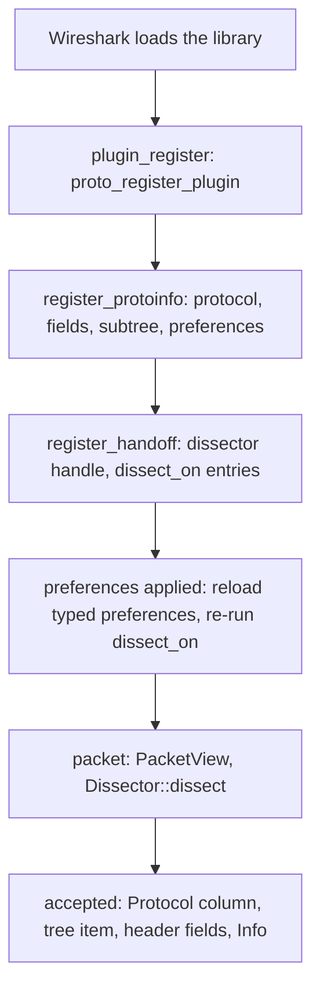

# Architecture

## Crates

| Crate | Depends on | Holds |
| --- | --- | --- |
| `libwireshark-sys` | bindgen, pkg-config (build) | bindings generated from the header bundles; links Wireshark |
| `libwireshark` | `libwireshark-sys`, libloading; `libwireshark-derive` with `derive` | the plugin API and its runtime |
| `libwireshark-derive` | syn, quote | `#[derive(Header)]`, `#[derive(Preferences)]` |
| `cargo-wireshark` | clap, bindgen, ureq, archive readers | installation discovery; bundle generation and the `headers` branch |

`examples/` are plugin `cdylib`s; `libwireshark`'s tshark test loads them.

## Header bundles

A bundle is one self-contained C header. `wireshark-<major>-<minor>.h` holds
a release line's declared public headers (`epan`, `epan/dfilter`,
`epan/ftypes`, and the TCP/UDP dissector headers) with their transitive
includes and the `config.h`/`ws_version.h` defines; it is the same for every
target. `deps-<os>-<arch>.h` holds the GLib and Gcrypt headers of one
target, reachable from `glib.h`, `gmodule.h` and `gcrypt.h`; one per target
serves every release line. Embedded files are labelled by their path below
their include root, never by where the generator found them.

`cargo wireshark headers generate` writes them from Wireshark's release tags
without configuring or building Wireshark; `publish` commits them to the
`headers` branch. The sys crate's build looks for its two bundles in
`WIRESHARK_BUNDLE_DIR`, the crate's `headers/` (where the published crate
carries them), then the checkout's `headers` branch, and runs bindgen over
an umbrella that includes the deps bundle first.

## A plugin at run time

`plugin!(A, B)` expands, in the plugin crate, to a `static` `Plugin` built
from `Protocol::of::<A>()` and `Protocol::of::<B>()` (each a table of
functions monomorphised for that `Dissector`), `TapSpec::of::<T>()` for
each tap and `FilterSpec::of::<F, ThisPlugin>()` for each filter function,
the `extern "C"` callbacks C cannot give a data pointer to (registration,
preference apply, cleanup, the heuristic entry point, tap and filter
registration) forwarding to it, and the exports Wireshark's loader reads.
A filter function's callback has no data pointer either, so it is
monomorphised for the function and for `ThisPlugin`, a type the macro
expands whose `PluginStatic` impl returns the static; so is a file
format's open routine, which needs the file type number registration gave
it. `plugin_register` hands Wireshark a table per interface the plugin
uses (`Tables`): protocols, taps, display-filter functions (4.4+), file
formats (4.6+) and codecs.
Callbacks that do carry a data pointer (dissection, TCP framing, taps) are
shared by every plugin and find their state through it. Where a callback's
C signature differs between release lines (heuristic and tap results, the
tap packet callback's flags), the runtime picks its function from the
binding's function-pointer type.

Display-filter functions exist from 4.4, so their symbols are resolved from
the running Wireshark rather than linked: a plugin for an older line loads
and registers none. Each borrows the argument check of the built-in `count`
or `string`, so every check, and the error it raises, stays in C.

File formats and codecs live in libwiretap and libwsutil, which the sys
crate does not link, so their functions are resolved the same way. A file
reader fills `struct wtap`, public from 4.6.2 (`wiretap/wtap_module.h`) and
private before; the runtime declares only the start of it, which is the
same in every 4.6 release, and reaches it through Wireshark's pointer.
`libwireshark-sys` reports its release line (`DEP_WIRESHARK_VERSION`), and
`libwireshark`'s build script compiles the reader only from 4.6, where a
record carries its own data buffer. Codec callbacks take a
`codec_context_t` from 4.2 and the decoder itself before; both sets are
compiled, and registration picks the release line's.

Each protocol's field ids, subtree id and short name are fixed once
registered and live in a boxed `Shared` whose address is the dissector
handle's callback data. Its typed preferences are an `Arc` rebuilt only
when Wireshark applies preferences, so a packet costs a mutex lock and a
reference-count increment, and no allocation. Registration state is guarded
by the plugin's mutex and lives for the process.
