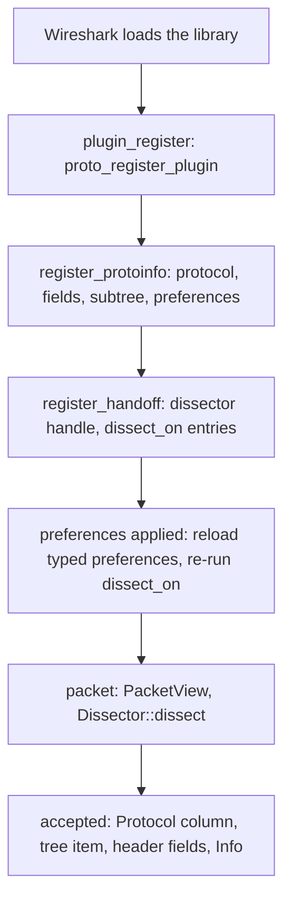

# Architecture

## Crates

| Crate | Depends on | Holds |
| --- | --- | --- |
| `libwireshark-sys` | bindgen, pkg-config (build) | bindings generated from the header bundles; links Wireshark |
| `libwireshark` | `libwireshark-sys`, libloading; `libwireshark-derive` with `derive` | the plugin API and its runtime |
| `libwireshark-derive` | syn, quote | `#[derive(Header)]`, `#[derive(Preferences)]` |
| `cargo-wireshark` | clap, bindgen, ureq, archive readers | installation discovery; bundle generation and the `headers` branch |

`examples/` are plugin `cdylib`s; `libwireshark`'s tshark test loads them.

## Header bundles

A bundle is one self-contained C header. `wireshark-<major>-<minor>.h` holds
a release line's declared public headers (`epan`, `epan/dfilter`,
`epan/ftypes`, and the TCP/UDP dissector headers) with their transitive
includes and the `config.h`/`ws_version.h` defines; it is the same for every
target. `deps-<os>-<arch>.h` holds the GLib and Gcrypt headers of one
target, reachable from `glib.h`, `gmodule.h` and `gcrypt.h`; one per target
serves every release line. Embedded files are labelled by their path below
their include root, never by where the generator found them.

`cargo wireshark headers generate` writes them from Wireshark's release tags
without configuring or building Wireshark; `publish` commits them to the
`headers` branch. The sys crate's build looks for its two bundles in
`WIRESHARK_BUNDLE_DIR`, the crate's `headers/` (where the published crate
carries them), then the checkout's `headers` branch, and runs bindgen over
an umbrella that includes the deps bundle first.

## A plugin at run time

`plugin!(A, B)` expands, in the plugin crate, to a `static` `Plugin` built
from `Protocol::of::<A>()` and `Protocol::of::<B>()` (each a table of
functions monomorphised for that `Dissector`) and `TapSpec::of::<T>()` for
each tap, the `extern "C"` callbacks C cannot give a data pointer to
(registration, preference apply, cleanup, the heuristic entry point, tap
registration) forwarding to it, and the exports Wireshark's loader reads.
Callbacks that do carry a data pointer (dissection, TCP framing, taps) are
shared by every plugin and find their state through it. Where a callback's
C signature differs between release lines (heuristic and tap results, the
tap packet callback's flags), the runtime picks its function from the
binding's function-pointer type.

Each protocol's field ids, subtree id and short name are fixed once
registered and live in a boxed `Shared` whose address is the dissector
handle's callback data. Its typed preferences are an `Arc` rebuilt only
when Wireshark applies preferences, so a packet costs a mutex lock and a
reference-count increment, and no allocation. Registration state is guarded
by the plugin's mutex and lives for the process.
