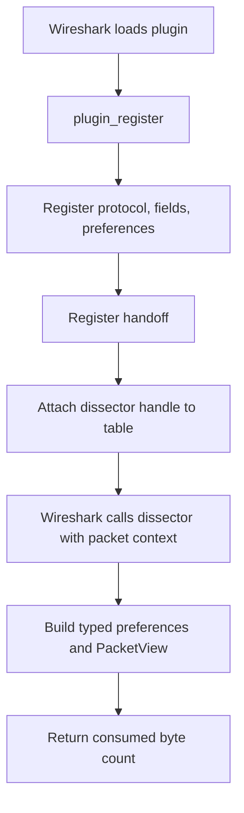

# Architecture

## Workspace components

| Component | Responsibility |
| --- | --- |
| `crates/libwireshark-sys` | Generates Rust declarations from a versioned self-contained public-header bundle and links a matching Wireshark SDK or runtime library. |
| `crates/libwireshark` | Exposes the plugin runtime, typed preference and header traits, protocol registration, table attachment, and callback-scoped packet access. |
| `crates/libwireshark-macros` | Provides optional derives for preferences and header fields and the plugin-entry attribute. |
| `crates/cargo-wireshark` | Provides independent runtime/SDK inspection and header/binding generation commands. |
| `examples/` | Builds example `cdylib` plugins. |

Runtime dependencies point from `libwireshark` to `libwireshark-sys`. The optional macro dependency points from `libwireshark` to `libwireshark-macros`; generated code calls the runtime API. `cargo-wireshark` has no runtime dependency and can be used independently.

## Plugin description and registration

One plugin shared library may register multiple protocols. A type implementing `WiresharkPlugin` returns a static slice of `ProtocolRegistration` values from `protocols()`. A registration can construct a protocol from a `Dissector` implementation or from a custom builder function. Each protocol descriptor has its own fields, preferences, dissector callback, and table attachments. The runtime retains one callback context per protocol and routes Wireshark's callback data to the matching descriptor. A `Dissector` implementation declares protocol names, associated `Preferences` and `Header` types, a packet callback returning `Option<DissectResult<Header>>`, and a static slice of fixed table attachments. A successful result carries the decoded header, consumed byte count, and optional Info-column text; the runtime applies these to Wireshark. Header field metadata and fixed table attachments are static slices. Preference-dependent table attachments are recomputed by `dissect_on` when Wireshark applies protocol preferences. `Dissector::protocol()` converts these declarations into the runtime `Protocol` descriptor. The callback bridge reads Wireshark's current preference map into the associated Rust preference type before calling the dissector. `PluginOptions` currently supplies the exported plugin version; protocol preferences remain per-protocol.

The `Preferences` derive emits the `prefs::Preferences` implementation for named structs with `bool`, `u32`, and `String` fields. The `Header` derive implements field registration and applies decoded struct values to a packet tree for named structs whose fields have supported signed or unsigned integer types. `PacketView::add_header` is the runtime application method. `#[preference(...)]` and `#[header(...)]` attributes set Wireshark-facing names, descriptions, display formats, masks, and byte offsets. Both derive macros are available only with the runtime's `macros` feature; the traits and manual descriptor API remain available without it.

Wireshark loads the plugin shared library and reads its plugin metadata symbols. `plugin_register` registers protocol metadata. The protocol callback registers fields and preferences for each protocol; the handoff callback creates data-bearing dissector handles and attaches them to tables. Each handle's retained callback data identifies its protocol descriptor. The dissector callback receives borrowed packet, packet-info, and tree pointers. The runtime converts these to a callback-scoped `PacketView`, and contains Rust panics at C callback boundaries.

## Native bindings

`libwireshark-sys` selects `headers/<major>-<minor>-<os>-<arch>.h` based on the detected Wireshark version and Cargo target OS and architecture, unless `WIRESHARK_BINDGEN_HEADER` names an explicit header. It generates Rust bindings into Cargo's build output using bindgen. SDK discovery through pkg-config or explicit include/library paths is supported. When no SDK is found, the build links the installed runtime library; on Windows it creates an import library from DLL exports when needed. The self-contained C bundle embeds Wireshark, GLib, and Gcrypt header bodies plus generated configuration declarations, so runtime-only binding generation does not need SDK headers or Wireshark source. The sys crate does not build Wireshark.

`cargo wireshark headers` reads public header declarations from Wireshark source without running CMake. It resolves GLib/Gcrypt headers from supplied or system paths, or downloads hash-verified development archives declared by Wireshark, then embeds the transitive contents in the single-file output. Older source trees use the current Wireshark dependency manifest when their own declarations do not cover the target. The command can compare declarations with a DLL export table and emit a smaller export-filtered header. `crates/libwireshark-sys/scripts/generate-version-headers.ps1` checks out stable release-line tags in `wireshark-src` and generates OS- and architecture-suffixed bundles.

## Registration and dissection flow

